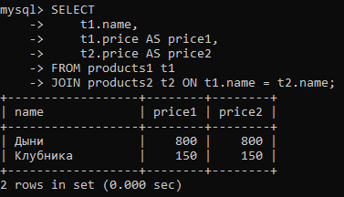
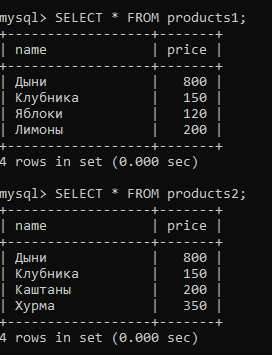
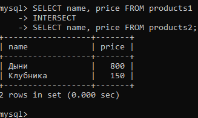
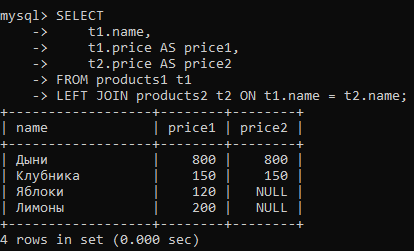
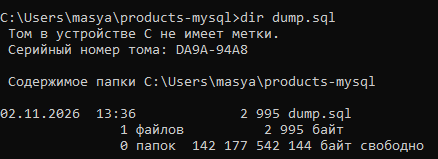
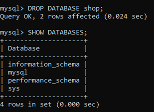
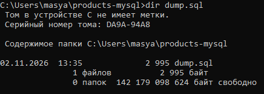
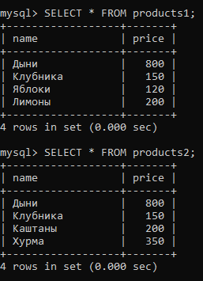
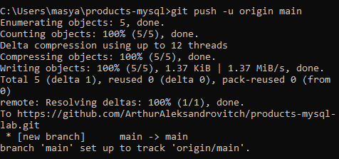

# Лабораторная работа: Основные SQL-операции MySQL

## 1. Описание работы

Цель лабораторной работы — изучить основные SQL-операции на примере двух таблиц `products1` и `products2`, используя MySQL 8.0+ в Docker-контейнере.

В ходе работы были созданы и заполнены таблицы, выполнены запросы для выборки, фильтрации, объединения и сравнения данных. Также было выполнено резервное копирование и восстановление базы данных.

## 2. Используемые технологии

- MySQL 8.0+
- Docker
- SQL
- Git
- GitHub

## 3. Создание базы данных и таблиц

Создана база данных `shop` с кодировкой `utf8mb4` и сортировкой `utf8mb4_unicode_ci`.

В базе данных созданы две таблицы:

### Таблица products1

| Название | Цена |
|---|---:|
| Дыни | 800 |
| Клубника | 150 |
| Яблоки | 120 |
| Лимоны | 200 |

### Таблица products2

| Название | Цена |
|---|---:|
| Дыни | 800 |
| Клубника | 150 |
| Каштаны | 200 |
| Хурма | 350 |

### Скриншот создания и заполнения таблиц



## 4. Выполненные SQL-операции

В ходе лабораторной работы были изучены и выполнены следующие операции:

| Операция | Назначение |
|---|---|
| SELECT | Выборка данных из таблицы |
| WHERE | Фильтрация записей по условию |
| UNION | Объединение результатов запросов без повторений |
| EXCEPT | Получение записей первой таблицы, отсутствующих во второй |
| INTERSECT | Получение общих записей двух таблиц |
| CROSS JOIN | Декартово произведение таблиц |
| JOIN | Объединение таблиц по совпадающим значениям |
| LEFT JOIN | Объединение с сохранением всех записей первой таблицы |
| DIVISION | Теоретически рассмотренная операция деления отношений |

### 4.1. SELECT и WHERE

Выполнена выборка названий товаров и фильтрация записей по условию цены больше 150.



### 4.2. INTERSECT

Операция позволяет получить записи, присутствующие в обеих таблицах.

Результат: Дыни и Клубника.



### 4.3. CROSS JOIN

Операция формирует декартово произведение двух таблиц. Поскольку в каждой таблице находится по четыре записи, результат содержит 16 строк.


### 4.4. LEFT JOIN

Операция позволяет получить все записи первой таблицы и соответствующие данные второй таблицы. Если совпадение отсутствует, возвращается значение `NULL`.



## 5. Резервное копирование базы данных

Для создания резервной копии использовалась утилита `mysqldump`.

Был создан файл `dump.sql`, содержащий структуру таблиц и данные базы данных.



## 6. Удаление базы данных

Для проверки восстановления база данных `shop` была удалена с помощью команды `DROP DATABASE`.

После удаления была выполнена проверка списка баз данных.



## 7. Восстановление базы данных

При первоначальном восстановлении возникла ошибка, связанная с параметром `GTID_PURGED`.

Для исправления была создана копия дампа `dump_fixed.sql`, из которой исключена соответствующая служебная команда.

После этого восстановление базы данных прошло успешно.



## 8. Проверка восстановленных данных

После восстановления проверено наличие таблиц `products1` и `products2`, а также всех исходных записей.

Обе таблицы содержат по четыре записи.



## 9. Публикация проекта на GitHub

Файлы лабораторной работы были добавлены в Git-репозиторий и отправлены на GitHub.

**Репозиторий:** [products-mysql-lab](https://github.com/ArthurAleksandrovitch/products-mysql-lab)



## 10. Структура проекта

```text
products-mysql/
│
├── README.md
├── dump.sql
├── dump_fixed.sql
├── my.cnf
│
└── screenshots/
    ├── 01-tables.png
    ├── 02-select-where.png
    ├── 05-intersect.png
    ├── 06-cross-join.png
    ├── 08-left-join.png
    ├── 09-dump.png
    ├── 10-drop-database.png
    ├── 11-restore.png
    ├── 12-verify.png
    └── 13-github.png
```

## 11. Итог

В результате лабораторной работы были изучены основные SQL-операции MySQL, созданы и заполнены две таблицы, выполнены запросы для обработки данных, а также освоены создание резервной копии и восстановление базы данных.

Работоспособность резервной копии подтверждена успешным восстановлением исходных таблиц и данных.